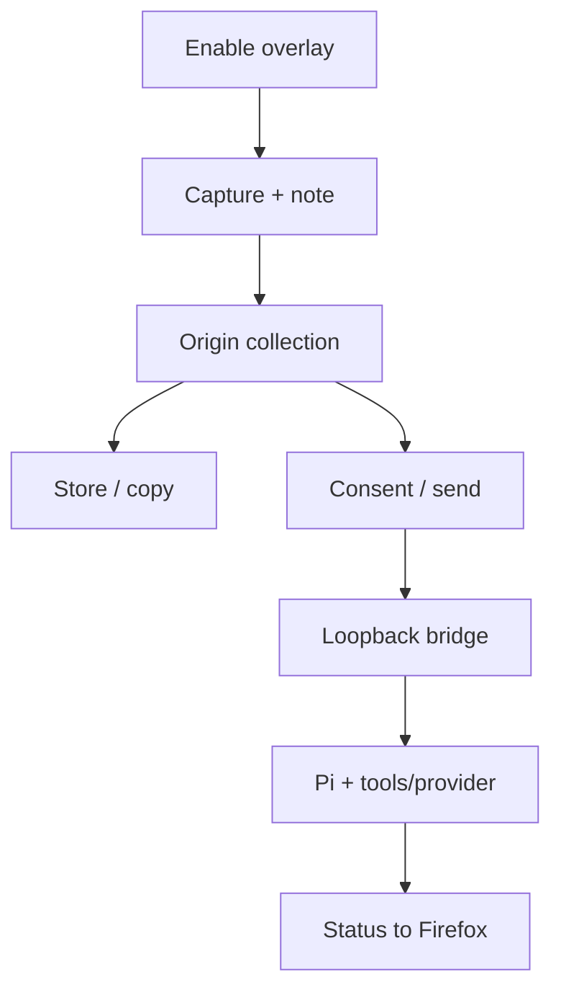

# Web Annotator for Pi: behavior walkthrough

Web Annotator for Pi collects change requests against webpage elements or selected text. Firefox can store and export a review without Pi. The optional loopback bridge delivers Markdown into the current Pi session; it does not itself locate source, edit files or verify a fix.

Reviewed behavior: package **2.0.3**, revision [`5462a3541bf4f95b9a9beafd4705bfaec473a62f`](https://github.com/pbjorklund/pi-web-annotator/tree/5462a3541bf4f95b9a9beafd4705bfaec473a62f). Runtime matches v2.0.3; the intervening change is `.gitignore`. This is the canonical behavior overview. [README](../README.md) owns setup; [PRIVACY](../PRIVACY.md) owns the privacy policy. Specialist procedures remain linked below.

## 1. Hosts and controls

Firefox desktop is supported, with manifest minimum version 140. Private windows are disabled. Firefox for Android is unsupported despite an Android minimum-version field in the manifest. There is no OpenCode adapter or registered model tool. Browser background entrypoint: `extension/background.js`. Pi entrypoint: `pi-extension/index.ts`, registered through `pi.extensions`.

Install from the [Firefox listing](https://addons.mozilla.org/en-US/firefox/addon/web-annotator-for-pi/). For Pi delivery, install `git:github.com/pbjorklund/pi-web-annotator`, restart Pi and run `/annotator-server start`. Browser-only use needs neither Pi nor model access. Fresh Pi sessions keep the bridge off, including RPC, JSON and print modes. First installation opens a bundled welcome tab; updates do not.

| Control | Effect |
| --- | --- |
| Toolbar / `Alt+Shift+A` | Toggle active tab overlay. |
| `Alt+A` / capture button | Pause/resume capture; keep panel open. |
| `Alt+T` / target button | Switch element/text mode. |
| `Alt+Shift+C` / Copy | Copy saved collection Markdown. |
| `Alt+Shift+J` | Copy saved collection JSON. |
| Row copy | Copy one annotation as Markdown. |
| `Ctrl+Enter` / `Cmd+Enter` | Save a new note and send when connected; save only while editing. |
| `Esc` | Cancel editor. |
| Panel title: arrows / `Home` | Dock / reset placement. |
| `/annotator-server [start\|stop\|status]` | Bridge lifecycle/status; no argument toggles start/stop. |

Keyboard handlers do not exclude editable page controls. Changing mode does not cancel an editor or scheduled text-selection callback. Pausing does not protect data already captured, displayed, copied or sent.

## 2. End-to-end flow



The background remembers enabled tab IDs in memory. It injects storage and overlay scripts after activation and reinjects after an enabled tab finishes navigation. Repeated injection detects an existing overlay. Closing a tab removes its enabled flag; background restart loses the set. This is not automatic capture across all sites.

Injection failure produces a red `!` badge and unsupported-page title. Protected pages such as `about:`, the Add-ons site, PDFs and `view-source:` are unavailable; other injection failures can produce the same badge.

## 3. Capture and editing

### Elements

With capture enabled in element mode, clicks outside annotation UI are intercepted. The green outline previews the hovered target; saved annotations use numbered pins. A record contains:

- full page URL/key, tag, ID/class, selector and preview;
- filtered attributes, synthesized opening tag, normalized `textContent`, label and ordinal hints;
- document-coordinate rectangle, colors and selected computed styles;
- opportunistic React, Svelte, Vue or Angular source/component metadata.

The attribute filter excludes selected runtime/noise names plus `style`, `id` and `class`; ID/class are stored separately. **It is not a sensitive-data allowlist.** Custom attributes and literal `value` attributes can remain. `textContent` can include hidden descendants. No password/sensitive-element exclusion exists. Do not capture targets containing secrets.

Attribute values retain 120 characters; element text and labels retain 80. Opening-tag content truncates at 240 before its suffix. Eight style properties are considered: font size/weight, padding, margin, display, border radius, width and height. These limits do not bound the record: URL, selector, ID/class, attribute count, note and collection size have no capture-level cap.

Selectors prefer a unique ID, otherwise tag/`nth-of-type` ancestry. They can become stale or ambiguous and are not source identities. Framework hints depend on debug metadata; missing hints do not prove static/server-rendered code, despite the environment banner's heuristic inference.

### Text

Text mode processes mouseup selection after 220 ms, normalizes whitespace and suppresses repeated identical text. Long selection/context retain 100-character head and tail joined by ` … `: up to 203 characters. Context starts with up to 50 characters on either side.

Capture immediately wraps the range in an amber `<mark>`, with extract/insert fallback, and aborts if wrapping fails. Geometry is measured afterward and need not match the original selection. Text records carry parent selector/tag, text, truncation flag, context, page identity, rectangle and mark selector, rather than element attributes/styles/framework hints.

### Save, edit and remove

A nonempty trimmed note becomes a timestamped `pending` record. Blank save cancels; cancelling text capture unwraps its temporary mark. Only pending notes are editable. Editing changes the note alone, retaining captured context, timestamp and ID; save rechecks pending status.

Editing disables collection/row action buttons; polling preserves these locks. Document-level copy shortcuts still export saved content, excluding unsaved editor text. Delete removes one local record; Clear confirms removal of the origin collection. Neither cancels a request already delivered to Pi.

## 4. State, navigation and durability

| Owner | State and lifetime |
| --- | --- |
| Background memory | Enabled tab IDs; lost on background restart. |
| Overlay memory | Loaded records, editor, target, connection flags and timers. |
| Firefox `storage.local` | `pi-web-annotator:collection:v1:` + origin; global `pi-web-annotator:panel-placement:v1`. |
| Bridge memory | At most 200 status entries per listener; no durable queue/result ledger. |
| Pi/provider | Messages, follow-ups, tools and configured transcript/provider retention; outside browser deletion. |

Origin means scheme, host and port. The panel lists the whole origin collection; pins match exact origin/path/query/fragment. **Send to Pi sends every pending note across that origin**, including other pages. Full URLs retain query and fragment data.

Storage replaces the entire collection, without cross-tab merge or a storage-change subscription. Concurrent tabs can overwrite snapshots. Website `localStorage` is untouched. Loading checks basic field shapes and drops invalid records, but does not require positive/integer/unique IDs or bound collection size. Load failure becomes an empty collection. Save/placement errors are silently swallowed: a visible saved row does not prove durable persistence.

Full navigation reloads storage. Wrapped history calls, `popstate` and `hashchange` schedule a 150 ms refresh: cancel editor and redraw pins, without reloading storage or restoring marks. Mount-time mark restoration searches individual text nodes under the parent selector and uses the head of truncated text. Changed/cross-node text may not restore. Pins fall back to faded saved coordinates and stack on collision. No mutation observer continuously tracks arbitrary DOM changes.

Panel placement is normalized, global across sites, clamped on move/resize and restored after load; pointer cancellation restores its previous position. Turning off removes nodes, marks, listeners and timers and restores history methods, while retaining saved records. In-flight setup, polls and sends are not cancelled or universally fenced against late continuations.

## 5. Exports and instructions

Markdown contains notes, URLs, text and available lookup hints. Element output includes opening tag, label, ordinal, selector and rectangle. Stored styles/colors, status, timestamps and job IDs are omitted. Collection JSON contains full current records, including those fields. There is no per-row JSON control.

Ordinary Copy and row Markdown have **no untrusted-data preface**. Pi sends and the `copyPrompt()` API prepend instructions to find source, implement the request and recheck in the browser, treating page data as untrusted. These instructions do not enforce tool access, source selection, browser verification or prompt-injection resistance. Page values enter Markdown without escaping or enforced data boundaries. Review requests before giving them to an agent.

Clipboard writes prefer `navigator.clipboard.writeText`, then a temporary textarea/`execCommand` fallback. The fallback ignores the command's boolean result; its success notification is not clipboard readback. The content-script API exposes items, Markdown/JSON, copy, clear, activate and destroy for background operations, not as model tools.

## 6. Optional bridge and consent

Browser requests use **`http://127.0.0.1:17373`**, `X-Pi-Web-Annotator: 1`, no-store fetches and a 1200 ms abort timer. `PI_WEB_ANNOTATOR_PORT` changes only the Pi listener; the browser endpoint stays fixed. Another port requires separately adapting the browser or test setup. Timeout does not undo accepted work.

Mount probes health immediately and every two seconds. Connected overlays request stored job-ID statuses. Health and status-ID traffic can occur without a new send/permission interaction; health carries no annotation text. The regular send path checks optional Firefox `browsingActivity` and `websiteContent` permissions. Without them it opens bundled `consent.html` and returns without sending that request. The consent button requests permission; the user returns and sends again. Granting permission does not resume the original send.

This UI flow is not server-side consent enforcement: the background send/status relay does not independently repeat the permission check, and HTTP does not verify Firefox consent. The constant marker header is not a secret, user authentication or proof of a human action. Loopback binding and absence of permissive CORS headers limit browser access; local software able to send the header can submit jobs. Do not expose/proxy this listener to other devices.

| HTTP interface | Contract |
| --- | --- |
| `GET /health` | Marked request returns `{ok:true}`. |
| `POST /jobs` | JSON `id`, `prompt`, `annotationIds`; returns 202 and current status after delivery callback. |
| `POST /jobs/status` | JSON `ids`, at most 200; returns known statuses, omits unknown IDs. |

Missing marker returns 403. Bodies are limited to 256 KiB. Job IDs contain 8–100 ASCII letters, digits, `_` or `-`; prompt is nonblank and at most 100,000 characters; annotation IDs are 1–500 nonempty strings of at most 100 characters each. Retained duplicates return 409; malformed jobs 400; oversized bodies 413; callback failure removes the entry and returns 503; unknown routes return 404. No cancel/result-text endpoint, origin/user authentication, cost budget or workspace restriction exists.

The map records jobs before delivery and evicts oldest insertion entries above 200, including active ones. This is bounded status retention, not durable exactly-once delivery. Retrying with a new ID can duplicate delivered work. More than 200 distinct stored IDs can make browser status lookup fail; requests are not chunked automatically.

## 7. Queue, status and restart

One send can group several pending records under a shared job ID. Payload is prefixed Markdown plus string annotation IDs, **not complete stored JSON**. Rows become `sending`; HTTP success applies the recognized response status, defaulting to `sent`. Failure restores still-matching sending rows to pending, clears job metadata and marks disconnected. The generic toast can hide causes other than an offline server.

```text
pending -> sending -> sent -> in_progress -> completed
                                   error/abort -> pending
```

Idle Pi delivery marks active and calls `sendUserMessage` immediately; busy Pi receives a `followUp`. A hidden marker connects later user `message_start` to the job. Starting another marked job settles its predecessor using the failure flag. `agent_end` checks the last assistant stop reason for `aborted`/`error`; `agent_settled` marks pending/completed and clears active state. This is lifecycle status, not proof that files changed or browser verification passed.

| Browser state | Meaning |
| --- | --- |
| Empty checkbox | Pending; eligible for send/edit. |
| Spinner (`sending`) | Awaiting submission response. |
| Arrow (`sent`) | Accepted/queued. |
| Spinner (`in_progress`) | Bridge reports active work. |
| Checked (`completed`) | Lifecycle completion **or manual checking**. |

Pending/completed checkboxes toggle manually and clear job association. After a successful status response omits a job, `sent`/`in_progress` reset immediately; `sending` resets after 60 seconds. Disconnected/failed lookups leave state unchanged: there is no unconditional repair timer. Restart loses the bridge map, retaining Firefox records; reconciliation needs a reachable bridge and successful status lookup.

Pending selection happens before awaiting permission, without rechecking afterward. Overlapping sends can select the same rows; late successful responses can overwrite newer polled status. These are source-level race paths, not reproduced failures.

Stop/session shutdown closes the listener and HTTP connections, clears active state and removes only the `annotation-server` widget. Generation checks prevent late startup from installing a listener; concurrent starts share startup. **Stop does not cancel delivered Pi messages, follow-ups, tools or provider requests.** There is no durable job recovery or automatic retry.

The TUI widget shows `Annotator · listening/active · :port` only while running; it never starts the bridge. RPC/headless modes create no terminal widget. Receipt/queue/completion notifications prove neither durable storage nor correct implementation.

## 8. Privacy and authority

Extension storage is isolated from direct page-script access. **Rendered notes are not:** panel rows, editor controls and pin titles use ordinary page DOM that the visited page can inspect or alter. Attributes/text and full URLs may contain sensitive data even when not visibly displayed. Avoid secrets and untrusted sensitive pages. Storage isolation does not make this a confidential overlay or authenticated human-action boundary.

Clear/Delete do not retract clipboard copies, Pi messages, provider data or source edits. There is no developer-operated backend; Pi may use a remote provider and ordinary configured tools. Loopback describes only the Firefox-to-Pi hop. Starting the bridge and granting Firefox permission do not authorize unrelated credentials, file access, spending, deployments or services.

The demo's constrained tools are separate from normal operation: the bridge installs no sandbox. Read the [privacy policy](../PRIVACY.md), Pi/provider terms and configuration before sending.

## 9. Evidence and maintenance

Pinned source describes the reviewed implementation. Current source/tests decide later changes; source inspection does not prove installed-browser behavior or model reliability.

- [Capture/UI/navigation/exports](https://github.com/pbjorklund/pi-web-annotator/blob/5462a3541bf4f95b9a9beafd4705bfaec473a62f/src/browser/web-annotator.ts), [types](https://github.com/pbjorklund/pi-web-annotator/blob/5462a3541bf4f95b9a9beafd4705bfaec473a62f/src/browser-types.ts), [storage](https://github.com/pbjorklund/pi-web-annotator/blob/5462a3541bf4f95b9a9beafd4705bfaec473a62f/src/browser/annotation-storage.ts).
- [Background relay](https://github.com/pbjorklund/pi-web-annotator/blob/5462a3541bf4f95b9a9beafd4705bfaec473a62f/src/browser/background.ts), [consent](https://github.com/pbjorklund/pi-web-annotator/blob/5462a3541bf4f95b9a9beafd4705bfaec473a62f/src/browser/consent.ts), [manifest](https://github.com/pbjorklund/pi-web-annotator/blob/5462a3541bf4f95b9a9beafd4705bfaec473a62f/extension/manifest.json).
- [HTTP contract](https://github.com/pbjorklund/pi-web-annotator/blob/5462a3541bf4f95b9a9beafd4705bfaec473a62f/pi-extension/server.ts), [Pi registration/lifecycle](https://github.com/pbjorklund/pi-web-annotator/blob/5462a3541bf4f95b9a9beafd4705bfaec473a62f/pi-extension/index.ts).
- [UI tests](https://github.com/pbjorklund/pi-web-annotator/blob/5462a3541bf4f95b9a9beafd4705bfaec473a62f/test/web-annotator-ui.test.mts) inject generated scripts into synthetic pages, mock browser storage/Pi responses and cover placement, text capture/cancel, pins and pending-note editing in four cases. They do not establish real Firefox permission/isolation behavior.
- [Storage](https://github.com/pbjorklund/pi-web-annotator/blob/5462a3541bf4f95b9a9beafd4705bfaec473a62f/test/annotation-storage.test.mts), [background](https://github.com/pbjorklund/pi-web-annotator/blob/5462a3541bf4f95b9a9beafd4705bfaec473a62f/test/background-bridge.test.mts), [server](https://github.com/pbjorklund/pi-web-annotator/blob/5462a3541bf4f95b9a9beafd4705bfaec473a62f/test/annotation-server.test.mts) and [Pi](https://github.com/pbjorklund/pi-web-annotator/blob/5462a3541bf4f95b9a9beafd4705bfaec473a62f/test/pi-extension.test.mts) tests cover generated storage/relay, validation, loopback transitions, startup/shutdown and mocked host follow-ups. Passing tests do not establish store approval or a live model result.

Run `npm run check`, `npm run build`, `npm pack --dry-run` and the [release gate](https://github.com/pbjorklund/pi-web-annotator/blob/main/docs/RELEASING.md). Generated browser JS/CLI MJS must match TypeScript. The npm package includes the bridge, README, changelog and this overview; Firefox ZIP includes runtime, manifest, welcome/consent pages, icons and notices. AMO receives a separate committed-source archive. Packaging/workflow success does not establish signed AMO availability, installed updates or running-host reload.

Keep procedures in [CONTRIBUTING](https://github.com/pbjorklund/pi-web-annotator/blob/main/CONTRIBUTING.md), [demo instructions](https://github.com/pbjorklund/pi-web-annotator/blob/main/demo/README.md), [AMO listing](https://github.com/pbjorklund/pi-web-annotator/blob/main/docs/AMO-LISTING.md), [release procedure](https://github.com/pbjorklund/pi-web-annotator/blob/main/docs/RELEASING.md), [dependency security](https://github.com/pbjorklund/pi-web-annotator/blob/main/docs/DEPENDENCY-SECURITY.md) and [backport provenance](https://github.com/pbjorklund/pi-web-annotator/blob/main/docs/SECURITY-BACKPORT.md). Live demos use the configured provider and need separate consent/cost authority; screenshots use a simulation. Do not run a model demonstration merely to validate documentation.
