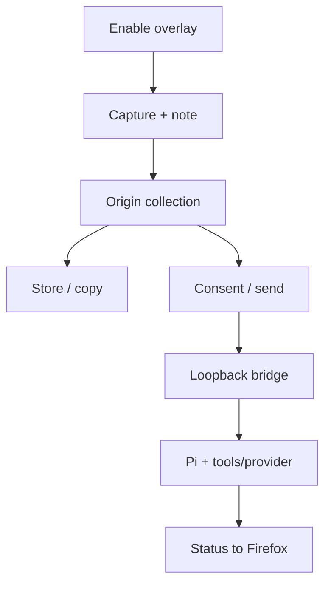

# Web Annotator for Pi: behavior walkthrough

Web Annotator for Pi collects change requests against webpage elements or selected text. Firefox can store and export a review without Pi. The optional loopback bridge delivers Markdown into the current Pi session; it does not itself locate source, edit files or verify a fix.

Reviewed candidate behavior: package **2.0.4**, implementation revision [`a40397ee7f01a2208bf2dd931ec509cca0ad9124`](https://github.com/pbjorklund/pi-web-annotator/tree/a40397ee7f01a2208bf2dd931ec509cca0ad9124). It combines fresh background data-permission checks, per-row send ownership, terminal overlay lifetimes and revisioned cross-tab storage. This source overview does not establish publication, installed-browser permission behavior or a running host's version. [README](../README.md) owns setup; [PRIVACY](../PRIVACY.md) owns the privacy policy. Specialist procedures remain linked below.

## 1. Hosts and controls

Firefox desktop is supported, with manifest minimum version 140. Private windows are disabled. Firefox for Android is unsupported despite an Android minimum-version field in the manifest. There is no OpenCode adapter or registered model tool. Browser background entrypoint: `extension/background.js`. Pi entrypoint: `pi-extension/index.ts`, registered through `pi.extensions`.

Install from the [Firefox listing](https://addons.mozilla.org/en-US/firefox/addon/web-annotator-for-pi/). For Pi delivery, install `git:github.com/pbjorklund/pi-web-annotator`, restart Pi and run `/annotator-server start`. Browser-only use needs neither Pi nor model access. Fresh Pi sessions keep the bridge off, including RPC, JSON and print modes. First installation opens a bundled welcome tab; updates do not.

| Control | Effect |
| --- | --- |
| Toolbar / `Alt+Shift+A` | Toggle active tab overlay. |
| `Alt+A` / capture button | Pause/resume capture; keep panel open. |
| `Alt+T` / target button | Switch element/text mode. |
| `Alt+Shift+C` / Copy | Copy saved collection Markdown. |
| `Alt+Shift+J` | Copy saved collection JSON. |
| Row copy | Copy one annotation as Markdown. |
| `Ctrl+Enter` / `Cmd+Enter` | Save a new note and send when connected; save only while editing. |
| `Esc` | Cancel editor. |
| Panel title: arrows / `Home` | Dock / reset placement. |
| `/annotator-server [start\|stop\|status]` | Bridge lifecycle/status; no argument toggles start/stop. |

Keyboard handlers do not exclude editable page controls. Changing mode does not cancel an editor or scheduled text-selection callback. Pausing does not protect data already captured, displayed, copied or sent.

## 2. End-to-end flow



The background remembers enabled tab IDs in memory. It injects storage and overlay scripts after activation and reinjects after an enabled tab finishes navigation. Repeated injection detects an existing overlay. Closing a tab removes its enabled flag; background restart loses the set. This is not automatic capture across all sites.

Injection failure produces a red `!` badge and unsupported-page title. Protected pages such as `about:`, the Add-ons site, PDFs and `view-source:` are unavailable; other injection failures can produce the same badge.

## 3. Capture and editing

### Elements

With capture enabled in element mode, clicks outside annotation UI are intercepted. The green outline previews the hovered target; saved annotations use numbered pins. A record contains:

- full page URL/key, tag, ID/class, selector and preview;
- filtered attributes, synthesized opening tag, normalized `textContent`, label and ordinal hints;
- document-coordinate rectangle, colors and selected computed styles;
- opportunistic React, Svelte, Vue or Angular source/component metadata.

The attribute filter excludes selected runtime/noise names plus `style`, `id` and `class`; ID/class are stored separately. **It is not a sensitive-data allowlist.** Custom attributes and literal `value` attributes can remain. `textContent` can include hidden descendants. No password/sensitive-element exclusion exists. Do not capture targets containing secrets.

Attribute values retain 120 characters; element text and labels retain 80. Opening-tag content truncates at 240 before its suffix. Eight style properties are considered: font size/weight, padding, margin, display, border radius, width and height. These limits do not bound the record: URL, selector, ID/class, attribute count, note and collection size have no capture-level cap.

Selectors prefer a unique ID, otherwise tag/`nth-of-type` ancestry. They can become stale or ambiguous and are not source identities. Framework hints depend on debug metadata; missing hints do not prove static/server-rendered code, despite the environment banner's heuristic inference.

### Text

Text mode processes mouseup selection after 220 ms, normalizes whitespace and suppresses repeated identical text. Long selection/context retain 100-character head and tail joined by ` … `: up to 203 characters. Context starts with up to 50 characters on either side.

Capture immediately wraps the range in an amber `<mark>`, with extract/insert fallback, and aborts if wrapping fails. Geometry is measured afterward and need not match the original selection. Text records carry parent selector/tag, text, truncation flag, context, page identity, rectangle and mark selector, rather than element attributes/styles/framework hints.

### Save, edit and remove

A nonempty trimmed note becomes a timestamped `pending` record after confirmed persistence; Save and send waits for that confirmation. Temporary text marks use negative IDs until the background allocates a saved positive ID. Blank save cancels; cancelling text capture unwraps its temporary mark. Only pending, unreserved notes are editable. Editing changes the note alone, retaining captured context, timestamp and ID; save rechecks row membership, pending status and ownership. Rows reserved by an outstanding consent/send attempt are not editable.

Editing disables collection/row action buttons; polling preserves these locks. Document-level copy shortcuts still export saved content, excluding unsaved editor text. Delete removes one local record; Clear confirms removal of the origin collection. Neither cancels a request already delivered to Pi.

## 4. State, navigation and durability

| Owner | State and lifetime |
| --- | --- |
| Background memory | Enabled tab IDs and per-origin storage queues; lost on background restart. |
| Overlay memory | Records, confirmed storage snapshot/revisions, retained editor draft, target, connection flags, timers and per-object send owners/revisions. |
| Firefox `storage.local` | `pi-web-annotator:collection:v2:` + origin: collection revision, increasing next ID and revisioned annotation rows; global `pi-web-annotator:panel-placement:v1`. Legacy v1 arrays are emptied after confirmed migration. |
| Bridge memory | At most 200 status entries per listener; no durable queue/result ledger. |
| Pi/provider | Messages, follow-ups, tools and configured transcript/provider retention; outside browser deletion. |

Origin means scheme, host and port. The panel lists the whole origin collection; pins match exact origin/path/query/fragment. **Send to Pi sends every pending note across that origin**, including other pages. Full URLs retain query and fragment data.

The content script sends typed collection operations to a background coordinator, which verifies the sender origin, serializes that origin's operations, reads fresh storage inside the queue and commits one new envelope. Create allocates a positive safe integer centrally; IDs are not reused after Delete or Clear. Edit/delete require the current row revision; Clear requires the current collection revision. First committed competing mutation wins; stale requests return an authoritative conflict snapshot without a partial batch write. Independent rows and creates remain preserved. Storage-change subscriptions synchronize tabs while unchanged row objects retain identity. Foreign row revisions invalidate stale send claims, even when their values match.

Migration normalizes supported legacy partial records and repairs duplicate/invalid numeric IDs and text-mark selectors. Malformed essential data refuses the whole import instead of silently discarding notes. A confirmed v2 envelope precedes legacy cleanup; a migration-phase flag makes cleanup retryable without reimporting v1 over v2. There is no durable operation/deleted-note log. Website `localStorage` is untouched. Reload every previously enabled tab after upgrading: mixed old injected writers and out-of-band storage edits are not coordinated.

Save/delete/Clear update the visible collection only after persistence confirmation. Failed loads are not empty collections. A failed or unconfirmed mutation retains the editor draft, reports an error/conflict and blocks further mutations until explicit **Reload saved** succeeds. The recovery control moves into an open editor so it remains usable without cancelling the draft. Reload neither discards the draft nor retries save/send; a lost reply can mean a commit happened, so review saved rows before retrying. Panel-placement errors remain silent. Clear removes saved notes but retains revision/ID metadata and the origin key; other tabs' unsaved drafts can remain in memory.

Full navigation reloads storage. Wrapped history calls, `popstate` and `hashchange` schedule a 150 ms refresh: cancel editor and redraw pins, without reloading storage or restoring marks. Mount-time mark restoration searches individual text nodes under the parent selector and uses the head of truncated text. Changed/cross-node text may not restore. Pins fall back to faded saved coordinates and stack on collision. No mutation observer continuously tracks arbitrary DOM changes.

Panel placement is normalized, global across sites, clamped on move/resize and restored after load; pointer cancellation restores its previous position. Turning off retires the instance: it removes its nodes, owned marks, listeners and polling timer, and restores history methods only while it still owns the wrappers. A replacement notifies the predecessor before installing new UI/history wrappers. Destroyed or replaced instances cannot finish mounting, mutate rows from late bridge replies, restart polling or act through retained controls. Deferred DOMContentLoaded and delayed UI callbacks are fenced too. These guards prevent new overlay actions; they do not cancel requests, clipboard writes or storage writes already admitted.

## 5. Exports and instructions

Markdown contains notes, URLs, text and available lookup hints. Element output includes opening tag, label, ordinal, selector and rectangle. Stored styles/colors, status, timestamps and job IDs are omitted. Collection JSON contains full current records, including those fields. There is no per-row JSON control.

Ordinary Copy and row Markdown have **no untrusted-data preface**. Pi sends and the `copyPrompt()` API prepend instructions to find source, implement the request and recheck in the browser, treating page data as untrusted. These instructions do not enforce tool access, source selection, browser verification or prompt-injection resistance. Page values enter Markdown without escaping or enforced data boundaries. Review requests before giving them to an agent.

Clipboard writes prefer `navigator.clipboard.writeText`, then a temporary textarea/`execCommand` fallback. The fallback ignores the command's boolean result; its success notification is not clipboard readback. The content-script API exposes items, Markdown/JSON, copy, clear, activate and destroy for background operations, not as model tools.

## 6. Optional bridge and consent

Browser requests use **`http://127.0.0.1:17373`**, `X-Pi-Web-Annotator: 1`, no-store fetches and a 1200 ms abort timer. `PI_WEB_ANNOTATOR_PORT` changes only the Pi listener; the browser endpoint stays fixed. Another port requires separately adapting the browser or test setup. Timeout does not undo accepted work.

Mount probes health immediately and every two seconds; health carries no annotation text and remains usable without optional data permission. Connected overlays request stored job-ID statuses without a new send action, but the background requires fresh permission for each status relay. The regular send path checks optional Firefox `browsingActivity` and `websiteContent` permissions. Without them it opens bundled `consent.html` and returns without sending that request. The consent button requests permission; the user returns and sends again. Granting permission does not resume the original send.

The background independently calls `permissions.contains` for both `browsingActivity` and `websiteContent` before each send/status relay, requiring literal true before serializing its body or calling fetch. Denied/revoked permission, missing APIs, thrown/rejected queries or nonboolean results return `{ok:false,error}` without fetching, requesting permission or opening a consent tab. The normal explicit consent UI remains separate. Grants and denials are not cached across requests; a later explicit grant can enable a later relay. Unknown messages still return undefined synchronously.

This is point-in-time browser-request admission, not a permission lease or cancellation of already-admitted requests. Revocation cannot retract content already sent or cancel delivered Pi work. It is not server-side consent enforcement: HTTP does not verify Firefox consent. The constant marker header is not a secret, user authentication or proof of a human action. Loopback binding and absence of permissive CORS headers limit browser access; local software able to send the header can submit jobs. Do not expose/proxy this listener to other devices.

| HTTP interface | Contract |
| --- | --- |
| `GET /health` | Marked request returns `{ok:true}`. |
| `POST /jobs` | JSON `id`, `prompt`, `annotationIds`; returns 202 and current status after delivery callback. |
| `POST /jobs/status` | JSON `ids`, at most 200; returns known statuses, omits unknown IDs. |

Missing marker returns 403. Bodies are limited to 256 KiB. Job IDs contain 8–100 ASCII letters, digits, `_` or `-`; prompt is nonblank and at most 100,000 characters; annotation IDs are 1–500 nonempty strings of at most 100 characters each. Retained duplicates return 409; malformed jobs 400; oversized bodies 413; callback failure removes the entry and returns 503; unknown routes return 404. No cancel/result-text endpoint, origin/user authentication, cost budget or workspace restriction exists.

The map records jobs before delivery and evicts oldest insertion entries above 200, including active ones. This is bounded status retention, not durable exactly-once delivery. Retrying with a new ID can duplicate delivered work. More than 200 distinct stored IDs can make browser status lookup fail; requests are not chunked automatically.

## 7. Queue, status and restart

One send can group several pending records under a shared job ID. Payload is prefixed Markdown plus string annotation IDs, **not complete stored JSON**. Before awaiting consent, the overlay reserves eligible row objects in memory. Overlapping selections skip already-owned rows without queuing another attempt; disjoint unreserved rows can progress. After consent, the attempt rechecks instance lifetime, row membership, revision, ownership and pending status. Delete/Clear or a manual checkbox change invalidate old selections, including checkbox ABA and reused numeric IDs. Denial releases the claim but never replays it automatically.

Rows are marked `sending` after the foreground consent check succeeds and persisted as a group before the background relay admits or refuses the request. The payload is built only after that await and a final ownership filter, excluding rows whose invalidation has been observed before that check. A matching already-committed internal status batch can acknowledge its authoritative conflict snapshot without a replay or new write; user edits still require current revisions. A POST reply can update only the same owned row object, job and revision while still `sending`; recognized success status defaults to `sent`. A matching failure restores pending and clears job metadata. If polling or a newer user action superseded every row, the late POST cannot regress those rows or connection feedback. Polls snapshot queried row objects, jobs, revisions and states; stale results cannot update replacement or unqueried rows. Late health replies cannot overwrite newer connection evidence, and older send-flash timers cannot erase newer feedback.

```text
pending -> sending -> sent -> in_progress -> completed
                                   error/abort -> pending
```

Idle Pi delivery marks active and calls `sendUserMessage` immediately; busy Pi receives a `followUp`. A hidden marker connects later user `message_start` to the job. Starting another marked job settles its predecessor using the failure flag. `agent_end` checks the last assistant stop reason for `aborted`/`error`; `agent_settled` marks pending/completed and clears active state. This is lifecycle status, not proof that files changed or browser verification passed.

| Browser state | Meaning |
| --- | --- |
| Empty checkbox | Pending; eligible for send/edit. |
| Spinner (`sending`) | Awaiting submission response. |
| Arrow (`sent`) | Accepted/queued. |
| Spinner (`in_progress`) | Bridge reports active work. |
| Checked (`completed`) | Lifecycle completion **or manual checking**. |

Pending/completed checkboxes toggle manually and clear job association. After a successful status response omits a job, `sent`/`in_progress` reset immediately; `sending` resets after 60 seconds. Disconnected/failed lookups leave state unchanged: there is no unconditional repair timer. Restart loses the bridge map, retaining Firefox records; reconciliation needs a reachable bridge and successful status lookup.

A failed or timed-out response does not prove non-delivery. Inspect Pi before explicitly sending again: a retry uses a new job ID and can duplicate already-accepted work. In-memory ownership fences are per overlay; storage revisions coordinate competing same-origin tabs and invalidate stale claims. Neither provides durable delivery or exactly-once execution across tabs or devices. They cannot retract an admitted POST or storage write.

Stop/session shutdown closes the listener and HTTP connections, clears active state and removes only the `annotation-server` widget. Generation checks prevent late startup from installing a listener; concurrent starts share startup. **Stop does not cancel delivered Pi messages, follow-ups, tools or provider requests.** There is no durable job recovery or automatic retry.

The TUI widget shows `Annotator · listening/active · :port` only while running; it never starts the bridge. RPC/headless modes create no terminal widget. Receipt/queue/completion notifications prove neither durable storage nor correct implementation.

## 8. Privacy and authority

Extension storage is isolated from direct page-script access. **Rendered notes are not:** panel rows, editor controls and pin titles use ordinary page DOM that the visited page can inspect or alter. Attributes/text and full URLs may contain sensitive data even when not visibly displayed. Avoid secrets and untrusted sensitive pages. Storage isolation does not make this a confidential overlay or authenticated human-action boundary. The [native Firefox assessment](https://github.com/pbjorklund/pi-web-annotator/blob/main/docs/DOM-ISOLATION.md) verifies page-script reads, persisted Edit/Save, status/deletion and synthetic row Send under explicit permission conditions. Its report and fixture change no runtime behavior; broader controls and mitigation acceptance remain separate.

Clear/Delete do not retract clipboard copies, Pi messages, provider data or source edits. There is no developer-operated backend; Pi may use a remote provider and ordinary configured tools. Loopback describes only the Firefox-to-Pi hop. Starting the bridge and granting Firefox permission do not authorize unrelated credentials, file access, spending, deployments or services.

The demo's constrained tools are separate from normal operation: the bridge installs no sandbox. Read the [privacy policy](../PRIVACY.md), Pi/provider terms and configuration before sending.

## 9. Evidence and maintenance

Pinned source describes the reviewed implementation. Current source/tests decide later changes; source inspection does not prove installed-browser behavior or model reliability.

- [Capture/UI/navigation/exports](https://github.com/pbjorklund/pi-web-annotator/blob/a40397ee7f01a2208bf2dd931ec509cca0ad9124/src/browser/web-annotator.ts), [types](https://github.com/pbjorklund/pi-web-annotator/blob/a40397ee7f01a2208bf2dd931ec509cca0ad9124/src/browser-types.ts), [storage](https://github.com/pbjorklund/pi-web-annotator/blob/a40397ee7f01a2208bf2dd931ec509cca0ad9124/src/browser/annotation-storage.ts).
- [Background relay](https://github.com/pbjorklund/pi-web-annotator/blob/a40397ee7f01a2208bf2dd931ec509cca0ad9124/src/browser/background.ts), [consent](https://github.com/pbjorklund/pi-web-annotator/blob/a40397ee7f01a2208bf2dd931ec509cca0ad9124/src/browser/consent.ts), [manifest](https://github.com/pbjorklund/pi-web-annotator/blob/a40397ee7f01a2208bf2dd931ec509cca0ad9124/extension/manifest.json).
- [HTTP contract](https://github.com/pbjorklund/pi-web-annotator/blob/a40397ee7f01a2208bf2dd931ec509cca0ad9124/pi-extension/server.ts), [Pi registration/lifecycle](https://github.com/pbjorklund/pi-web-annotator/blob/a40397ee7f01a2208bf2dd931ec509cca0ad9124/pi-extension/index.ts).
- [UI tests](https://github.com/pbjorklund/pi-web-annotator/blob/a40397ee7f01a2208bf2dd931ec509cca0ad9124/test/web-annotator-ui.test.mts) inject generated scripts into synthetic pages, mock browser storage/Pi responses and cover placement, text capture/cancel, pins and pending-note editing in four cases. They do not establish real Firefox permission/isolation behavior.
- [Continuation regressions](https://github.com/pbjorklund/pi-web-annotator/blob/a40397ee7f01a2208bf2dd931ec509cca0ad9124/test/send-continuations.test.mts) hold synthetic consent, POST, health, status and storage replies in Playwright Firefox. They cover overlapping and disjoint sends, invalidation/ABA, explicit retry, newer status/connection/feedback, teardown, deferred mounting and pending/mounted namespace replacement. Mounted replacement also checks successor text marks, retained controls, active interval counts and history restoration. These are synthetic browser/runtime tests, not installed-extension or live Pi/model evidence.
- [Broker regressions](https://github.com/pbjorklund/pi-web-annotator/blob/a40397ee7f01a2208bf2dd931ec509cca0ad9124/test/collection-broker.test.mts) exercise serialized fresh reads, origin checks, atomic batches, ID allocation, conflicts and migration failures. [Two-tab UI regressions](https://github.com/pbjorklund/pi-web-annotator/blob/a40397ee7f01a2208bf2dd931ec509cca0ad9124/test/cross-tab-ui.test.mts) run the in-memory-transpiled production broker with two synthetic Firefox pages and isolated storage. Deferred write/event/reply gates cover concurrent creates, independent edit/delete, stale edit/delete/Clear, failed-load/write recovery, unsaved text marks and deleted-row payload exclusion. No production collections or real Pi/model traffic are used.
- [Storage](https://github.com/pbjorklund/pi-web-annotator/blob/a40397ee7f01a2208bf2dd931ec509cca0ad9124/test/annotation-storage.test.mts), [background](https://github.com/pbjorklund/pi-web-annotator/blob/a40397ee7f01a2208bf2dd931ec509cca0ad9124/test/background-bridge.test.mts), [server](https://github.com/pbjorklund/pi-web-annotator/blob/a40397ee7f01a2208bf2dd931ec509cca0ad9124/test/annotation-server.test.mts) and [Pi](https://github.com/pbjorklund/pi-web-annotator/blob/a40397ee7f01a2208bf2dd931ec509cca0ad9124/test/pi-extension.test.mts) tests cover generated storage/relay, validation, loopback transitions, startup/shutdown and mocked host follow-ups. The generated-background fixtures also cover granted/denied/revoked permission, throwing/rejected/missing/nonboolean APIs, pending permission queries, re-grant, serialization-before-admission refusal and permission-independent health. Passing synthetic fixtures do not establish installed Firefox permission behavior, store approval or a live model result.

The 2.0.4 release also patches development Undici within the existing consumer majors to 7.30.2 and 8.12.4. Added offline regressions cover ASCII-whitespace integrity, redirect credentials, cache alias/freshness/Vary/revalidation, SQLite schema invalidation and replay failures. An isolated child configures the actual modular SDK dispatcher and checks wrong/matching TAB-prefixed digests against synthetic loopback HTTP. SDK pins, host minima, the local security backports and application runtime remain unchanged by this dependency repair. See [dependency security](DEPENDENCY-SECURITY.md); these npm overrides do not repair Node-embedded fetch or prebundled SDK CLI code.

Run `npm run check`, `npm run build`, `npm pack --dry-run` and the [release gate](https://github.com/pbjorklund/pi-web-annotator/blob/main/docs/RELEASING.md). Generated browser JS/CLI MJS must match TypeScript. The npm package includes the bridge, README, changelog and this overview; Firefox ZIP includes runtime, manifest, welcome/consent pages, icons and notices. AMO receives a separate committed-source archive. Packaging/workflow success does not establish signed AMO availability, installed updates or running-host reload.

Keep procedures in [CONTRIBUTING](https://github.com/pbjorklund/pi-web-annotator/blob/main/CONTRIBUTING.md), [demo instructions](https://github.com/pbjorklund/pi-web-annotator/blob/main/demo/README.md), [AMO listing](https://github.com/pbjorklund/pi-web-annotator/blob/main/docs/AMO-LISTING.md), [release procedure](https://github.com/pbjorklund/pi-web-annotator/blob/main/docs/RELEASING.md), [dependency security](https://github.com/pbjorklund/pi-web-annotator/blob/main/docs/DEPENDENCY-SECURITY.md) and [backport provenance](https://github.com/pbjorklund/pi-web-annotator/blob/main/docs/SECURITY-BACKPORT.md). Live demos use the configured provider and need separate consent/cost authority; screenshots use a simulation. Do not run a model demonstration merely to validate documentation.
